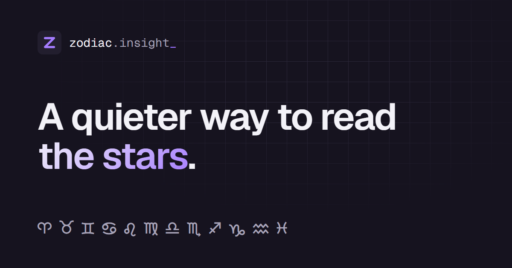

# Zodiac Insight

A minimal, calm horoscope site:

- **Daily readings**: today / tomorrow / this week, with a shareable card
- **The sky right now**: zodiac season, live moon phase and moon sign, and a retrograde tracker for all eight planets (real astronomy via `astronomy-engine`)
- **Birthday insights**: life path number, Chinese zodiac, birthstone, birth flower, birthday countdown
- **Sign profiles**: traits, ruling planet, modality, best and hardest matches, famous people
- **Your day**: today's real planetary transits to your own birth chart, plus a daily tarot card
- **Cosmic calendar**: sign changes, retrograde stations, full/new moons for 90 days, and eclipses a year ahead
- **Big Three + birth chart**: Sun, Moon and Rising, a chart wheel with all ten planets, whole-sign houses and aspects
- **Compatibility**: overall plus love / friendship / work, with the element dynamic explained
- **Daily streak** for returning visitors
- **Shareable links**: `?sign=leo` opens a sign, `?match=leo,aries` opens a pairing
- **Installable PWA**: add to home screen; works offline after the first visit



Everything runs in the browser. Readings are generated locally from a seeded template set, so the same sign on the same day always gives the same reading. No backend, no accounts, no tracking. The only data stored is your name, birthday, birth time/city, last sign, streak and theme, in your own browser's `localStorage`.

## Stack

React 18 · TypeScript · Vite · Tailwind CSS · Vitest

## Develop

```sh
npm ci          # install exact locked versions
npm run dev     # http://localhost:8080
npm test        # unit tests (sign dates, reading generator)
npm run lint
```

## CI

`.github/workflows/ci.yml` runs lint, type-check, tests, build and a production dependency audit on every push and pull request. Dependabot (`.github/dependabot.yml`) opens weekly grouped update PRs.

No scheduled content job is needed: everything (transits, moon, eclipses, readings) is computed live in the browser.

## Build & deploy

```sh
npm run build   # outputs static files to dist/
npm run preview # serve the production build locally
```

`dist/` is a static site. It's set up for **Vercel** (`vercel.json`): import the repo and deploy — no settings needed.

- **Security:** the build injects a Content-Security-Policy `<meta>` (see `csp()` in `vite.config.ts`); `vercel.json` adds HSTS, anti-framing and other headers, and long-lived caching for fingerprinted assets.
- **404s:** the build copies `index.html` to `404.html`, so unknown URLs show the app's own "not found" page.
- **Node:** 22.x (pinned in `package.json` → `engines`).
- **Social previews:** `og:image` in `index.html` is relative (`/og.png`). Some platforms need an absolute URL, so change it to `https://your-domain/og.png` once you have a domain.

## Project layout

```
src/
  data/zodiacs.ts      sign data + date → sign lookup
  lib/horoscope.ts     reading generator + compatibility score
  data/signProfiles.ts sign traits, rulers, famous people, element pairings
  data/cities.ts       birth cities (lat/lon/time zone) for the rising sign
  lib/sky.ts           planet positions, moon, retrogrades, season, Big Three (astronomy-engine)
  lib/chart.ts         birth chart, aspects, personal transits, cosmic calendar
  data/tarot.ts        the 22 Major Arcana
  lib/birthday.ts      life path, Chinese zodiac, birthstone, countdown
  lib/user.ts          localStorage helpers (name, last sign, birthday, streak)
  lib/utils.ts         class merge + local-date helpers
  components/          page sections
  pages/               Index (the app) and NotFound
```
